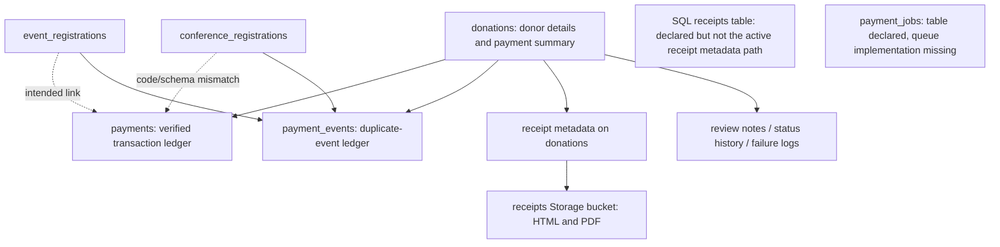

# Payment scripts and schema architecture review

Reviewed 2026-10-12. User confirms current payments are dummy/test payments and real payments have not been allowed. This is a source/script review, not live configuration verification. No SQL executed, payment attempted, schema changed or automated checks run.

Further clarification: user reports all scripts were run sequentially in Supabase and permits loss of all sandbox donation data. This allows a simpler donation-only reset during implementation instead of preserving/backfilling disposable records. Inspect actual deployed definitions and shared dependencies first. No reset was performed; event/conference records and unrelated site data are outside this permission.

Latest clarification supersedes earlier target-model recommendations: conference is retired and its records/tables may be deleted; event data is also test-only. The target ledger should support donations and events, not conference. S01's conference mismatch describes residual code to retire, rather than a reason to add conference support. First remove active conference API/action/payment/admin/cron consumers, then conference-exclusive tables/FKs/settings/files. Preserve modern events functionality and configuration. No removals performed here.

## What we actually have

The repository combines an original donation-centric system with a partially implemented V2 ledger. The useful foundation should be retained, but documentation describing the entire system as atomic, risk-free or fully backward compatible does not match all scripts and callers.

The SQL `receipts` table and the Storage bucket named `receipts` are different objects. Calls to `supabase.storage.from("receipts")` upload files; they do not populate the SQL table.

## Script families and their role

| Scripts | Role / dependency |
|---|---|
| `migrations/001`, `002`, `008` | Donation table, admin model/RLS/settings, currency/reporting. `008` fills NULL currency but does not change the original existing column default from INR. |
| `migrations/009` | Donation provider references and their unique indexes; initial payment_events ledger. |
| `migrations/010`, `011b` | Receipt metadata on donations, receipt audit log, original sequence function returning bigint. |
| `payments-v2/020`–`024` | Payments, SQL receipts, optional job table, enhanced events and indexes. These require earlier base tables; table creation is not proof the application uses them correctly. |
| `payments-v2/025`, `025b`–`029` | New text-returning annual receipt function, payment/error logs, confirmed_at and verification_id. |
| `migrations/030`, `031`, `032` | Admin review/audit model, Stripe ledger references/constraint, donation provider/message fields. |
| `migrations/017`, `017b` | Conference payment references/registration table. Check actual ordering/dependencies before executing. |
| `migrations/040b`, `041b` | Restrict public donation inserts, bank fields and private proof bucket. |
| `migrations/056`, `057b`, `059` | Shared event payment references, attempted ledger entity support, and review history for events/conferences. |
| `migrations/062` | Bank-display fields on events; this is not the bank-donation schema. |

Historical scripts should remain historical. Prepare new corrective migrations and an explicit dependency order after checking the deployed schema. Do not rerun the README's whole sequence blindly.

## Confirmed script/code mismatches

### S01: Shared payment ledger cannot represent current callers consistently — required fix

`payments-v2/020-create-payments-table.sql` requires `donation_id NOT NULL`. `migrations/057b-extend-payments-for-registrations.sql` adds event_registration_id and an exactly-one-owner check, but never drops that NOT NULL constraint. Therefore the event-only branch of its own check cannot be satisfied under the scripts as written.

The same migration allows only `donation` and `event_registration` entity types. `PaymentService.confirmConferenceRegistration` inserts `entity_type: conference_registration` and places its conference UUID in `event_registration_id`, whose FK targets event_registrations. The scripts do not define a conference owner column on payments. These writes can fail while payment status still succeeds because ledger insertion is nonfatal.

Recommended smallest correction: nullable donation/event owner FKs plus a NOT NULL entity_type and a check requiring exactly the matching one. Retire the conference caller rather than add a conference FK/type. Use ON DELETE RESTRICT for future financial ledger owners or another explicitly approved history-preservation policy. The existing event FK's SET NULL would conflict with its exactly-one-owner check when deleting an owner; settle deletion policy deliberately.

### S02: Receipt table declaration and active storage model differ — required decision

`payments-v2/021-create-receipts-table.sql` declares one SQL receipt per donation. `lib/receipts/service.ts` reads/updates donation receipt fields and uploads HTML/PDF to Storage. It does not use that SQL table as the authoritative receipt metadata store.

Choose one owner of receipt truth. For the planned monthly system, prefer a receipt linked to a verified collection (`payment_id`) with a unique collection relationship, unique number, document object path and delivery state. Donation-level receipt fields can remain compatibility summaries temporarily. Do not store a long-lived bearer download token as the durable file identity; mint scoped links when needed. Keep the Storage bucket for documents.

### S03: Receipt numbering has two incompatible implementations — required fix

`migrations/011b-receipt-sequence.sql` returns bigint, declares a side-effecting nextval function STABLE and runs a SELECT that consumes a number. `payments-v2/025-atomic-receipt-number.sql` drops/replaces it with a formatted TEXT return and a counter per year. Current `generateReceiptNumber` expects that text format.

The new annual table starts empty; the migration does not seed it from already-issued current-year numbers. Existing receipt numbers can collide with the restarted counter. The fallback reads the most recently created donation with a receipt, not a locked maximum, so concurrent requests can allocate the same number. A UNIQUE constraint rejects duplicates but does not guarantee successful issuance/recovery.

Keep one service-restricted, correctly volatile atomic number function. Seed its annual counters from valid issued numbers before switching callers. Define timezone/prefix and capacity explicitly; current LPAD to five characters truncates larger sequence values. Remove the production read-and-increment fallback; queue a retry when numbering is unavailable.

### S04: Financial data rules and permissions are incomplete — required fix

Payments and donations use fixed-precision decimals, which is appropriate for the supported two-decimal currencies, but need positive amount, supported currency/provider, non-null/default and status checks. Defaults differ across early migrations; normalize explicitly rather than silently changing historical currency.

The current payment uniqueness is `(donation_id, transaction_id)`. It does not establish global ownership of a provider transaction; nullable entity ownership also changes how UNIQUE behaves. Define stable collection identity and enforce `(provider, environment, canonical_transaction_ref)` uniqueness, including different events that represent the same charge. Subscription ID is not an individual monthly collection ID.

Several V2 tables have no explicit RLS/grant restrictions; payment_logs has commented-out RLS. Live exposure depends on actual grants. Add explicit permissions for tables, views and RPC functions, not just application checks. Preserve separate review_status and payment_status, but choose one canonical paid status and correct reviewer FKs.

### S05: Recovery schema is only partly usable — required fix

`payment_jobs` has status/retry fields but no job deduplication key, claim lease or recovery of abandoned processing jobs. Queue code is a placeholder. Add the minimum fields and atomic claim operation needed for a database worker; link jobs to collection/receipt as appropriate.

Failure tables use a BEFORE INSERT update-or-insert trigger without a unique unresolved-failure key. Two concurrent inserts can both see no unresolved row and insert duplicates. Use a partial unique index with atomic conflict handling if keeping a single unresolved record per owner/error category. Decide the category/job key rather than collapsing all failures for one subscription into one record. Plain CREATE TRIGGER is not rerunnable despite broad README claims.

### S06: Event/audit ownership is not consistently constrained — required fix

payment_events can have donation, event and conference FKs, but needs a clear owner rule for financial events and explicit handling of provider-wide events. Review/status tables make donation_id nullable in `059` without requiring exactly one owner. A row can have no owner or multiple owners under those scripts. Add checks appropriate to each table, not a blanket check that prevents legitimate provider lifecycle events.

Audit events should be append-only through trusted paths. Existing cascading deletes can erase payment/receipt/audit history. Agree on retention and deletion rather than assuming a dummy database can be dropped: it may also contain real donor contact details or registration records.

### S07: Migration claims and indexes need cleanup — secondary work

The V2 README says zero risk/no breaking changes and recommends destructive DROP/CASCADE rollback. That is not a safe production runbook. New code and NOT VALID constraints still enforce rules on new/updated rows; failures may be hidden by nonfatal ledger handling.

Some indexes duplicate existing uniqueness indexes or similar indexes under different names. Inspect actual indexes and query plans before removing any. Also validate constraints/backfills before claiming migrations succeeded. Consolidating all historical SQL or building a generalized payment framework is unnecessary for this task.

## Recommended target model

| Object | Responsibility |
|---|---|
| Existing donations / registration tables | The donor's intent or registration and a summary for current UI; not the complete financial history. |
| Payment attempts | A persisted checkout/request identity with provider, test/live environment, expected money, owner and provider reference; retries recover the same attempt. Add a small table only if adapting existing payments would mix attempts and immutable collections. |
| Existing payments | Actual verified collections, stable globally unique provider reference, verified amount/currency and correct owner. One row per monthly charge, never just one per subscription. |
| Existing payment_events | Durable callback inbox/processing evidence with provider/environment event uniqueness. |
| Existing receipts + Storage | Receipt issuance linked to each collection; private files in Storage. |
| Existing payment_jobs | Durable receipt/email/recovery work with deduplication and leases. |
| Subscription records | Subscription lifecycle and donor intent, separate from individual collections. Start with a narrow Stripe model if recurring is required. |
| Refund/adjustment records | Amount and provider identity linked to original collections; retain original payment truth. |
| Existing review/history/failure tables | Restricted admin decisions, reconciliation evidence, operational recovery and audit history. |

No need to introduce separate copies of all these tables. Reuse the existing ones; add only the missing responsibilities. Test/live environment should be stored explicitly on payment/event identities, even while all current payments are dummy.

## Next schema steps

1. Read-only live metadata inventory to see which version is deployed; schema-only export and aggregate consistency checks, without exporting donor data.
2. Finalize owner/status/transaction identity and receipt authority contracts before writing migrations.
3. Create additive corrective migrations for owner integrity, permissions, valid money/statuses, numbering and stable attempt/collection identity; stage and validate them in dependency order.
4. Implement transaction-based confirmation and durable receipt work against that schema. Database constraints alone do not repair non-atomic application writes.
5. Prove donation/event flows and repeated monthly invoices using dummy data; verify conference consumers are retired before live activation.

The current dummy-payment context and permission to discard donation/event test records and conference tables reduce migration complexity. They do not establish deployed database privacy or authorize deleting active event configuration and unrelated site records. Prepare the scoped reset/removal only after checking dependencies; nothing in this review requires enabling real payments now.
